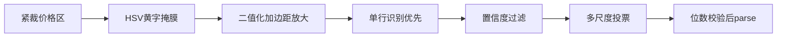

# OCR 准确率分析与优化计划

> 日期：2026-07-27  
> 状态：已评审（基于交易所实机截图）  
> 概述：价格数字是「淡黄字 + 贝壳图标 + 米色底 + 字距很紧」；当前灰度预处理会丢掉颜色对比，且完整检测链路容易拆错位数。计划优先做颜色分离 + 单行识别增强，针对性压低 9↔6 与位数错误。

## 实机截图结论

交易所结果页价格区特征：

- **价格**：淡黄/奶白数字，落在米色圆角条上（如 `129999`、`38888`、`36666`、`222222`）
- **左侧紧贴金色贝壳图标**：裁剪稍宽就会把图标当数字
- **字距极紧**：连续相同数字（`33333`、`222222`）几乎粘连
- **6/9 字形开口特征弱**：低分辨率 + 抗锯齿时极易互换
- 字体是游戏 UI 定制无衬线，但**不是重特效发光字**——更适合「颜色分离 + OCR 增强」，暂不必上逐位模板

**最直接原因**：把「淡黄字 + 米色底」先转成灰度再送给通用 OCR，黄字与底色亮度接近，笔画糊掉后 6/9 与位数错误被放大。

## 与当前实现的错位点

[`src/auto_auction/ocr.py`](../../../src/auto_auction/ocr.py) 现状：直接 `BGR → 灰度 → BGR` 后走完整 RapidOCR（det+cls+rec），并对 `txts` 盲目拼接。

| 截图现象 | 当前代码问题 | 典型误识 |
|---------|-------------|---------|
| 黄字/米色底对比靠色相 | 直接灰度，黄与底亮度接近 | 笔画糊、9↔6 |
| 贝壳图标贴数字 | 无颜色门控、裁剪无边距策略 | 多出 1 位或前缀噪点 |
| 字距紧、已是单行小图 | 仍走完整 det+cls+rec | 拆分/漏检 → 位数错 |
| 无置信度门槛 | `"".join(txts)` 全收 | 低分错误被采纳 |

目标链路：

## 优化方案（按落地顺序）

### 1. 价格专用颜色预处理

在 `ocr.py` 新增 `preprocess_price_crop(bgr) -> bgr`：

- HSV 提取淡黄/奶白字（可配置 `h/s/v` 范围）
- 形态学闭运算连回断裂笔画
- 白底黑字（或黑底白字）输出，再送 OCR
- 四周加 8–12px padding，固定放大到字高约 48–64px

成长数值若颜色不同，用独立预处理 profile（`price` / `growth`）。

### 2. 单行识别 + 置信度

- RapidOCR 优先跳过检测、只做识别；失败再回退全链路
- 读取 `scores`：低于阈值整次结果作废
- 单行场景只取分数最高的一条，或按 x 坐标排序后拼接

### 3. 多尺度投票

对同一裁剪跑 2–3 个尺度（如 1.0x / 1.5x / 2.0x）：

- 解析为数字后做多数投票
- 票数不足或候选冲突 → 记失败并存 debug 图，不瞎用

### 4. 业务侧位数与范围门闩

在 `state_machine` / 配置中增加：

- `price_digits_min/max`（截图多为 5–6 位）
- `price_value_max`
- 不满足则视为 OCR 失败（跳过该槽）

### 5. 标定与验证工具

增强 `--probe-ocr`：导出原裁剪 / 掩膜后 / 送入 OCR 的图，打印 `text / value / score / votes`；补充 fixture 与单测。

### 6. 裁剪标定建议

- 价格矩形左边界避开贝壳，只盖数字条
- README 补充「按颜色条紧裁」说明

## 主要改动文件

- `src/auto_auction/ocr.py`
- `src/auto_auction/settings.py` + `config/default.yaml`
- `src/auto_auction/calibrate.py`
- `src/auto_auction/state_machine.py`
- `tests/test_ocr_parse.py` + `tests/test_ocr_preprocess.py`
- `README.md`

## 验收标准

- 对本截图可见价格 `--probe-ocr`（或离线 fixture）目标 ≥7/8 完全正确，且无系统性 9↔6
- 低置信/投票冲突时宁可跳过，不产生错误「伪低价」
- 现有纯解析单测仍通过
